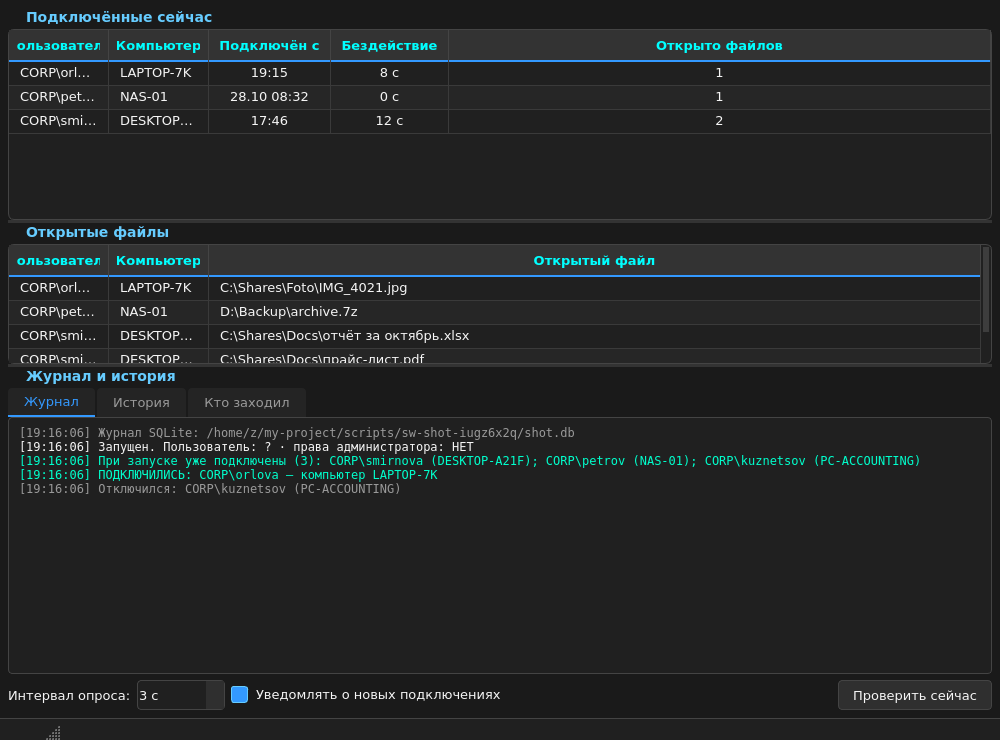

# Сетевой сторож (SmbWatchdog)


Сидит в трее и сообщает, кто заходит на ваш компьютер по сети: кто подключён
прямо сейчас, какие файлы открыты — и вся история визитов в SQLite.

Полезно, если папка расшарена для коллег или принтера, и хочется знать,
кто и когда заглядывал: общий доступ к диску, скрытые шары `C$`/`D$`,
сетевые принтеры — всё видно.



## Возможности

- **Уведомление при каждом новом подключении** — кто зашёл и с какого компьютера.
- **Кто подключён сейчас** — пользователь, компьютер, с какого времени, бездействие.
- **Открытые файлы** — какой файл держит каждый сеанс (подсказка в ячейке «Открыто файлов»).
- **История в SQLite** — все подключения, отключения, запуски и ошибки пишутся
  в базу; вкладки «История» (фильтр + поиск) и «Кто заходил» (сколько визитов,
  первый и последний раз).
- **Автозапуск с Windows** — старт сразу свёрнутым в трей, окно не появляется.
- **Счётчик на значке** — сколько сейчас подключено.
- Тёмная тема, один файл без установки, без консоли.

## Как это работает

Каждые N секунд программа опрашивает Windows через PowerShell:
`Get-SmbSession` (кто подключён) и `Get-SmbOpenFile` (какие файлы открыты),
сравнивает снимок с предыдущим и оповещает о новых подключениях.
Опрос асинхронный — интерфейс не замирает.

Все данные остаются на вашем компьютере: программа ничего не отправляет
в сеть и состоит из одного файла, который легко прочитать.

## Установка

1. Windows 10/11 и [Python 3.8+](https://www.python.org/downloads/)
   (при установке отметьте «Add python.exe to PATH»).
2. Установите PyQt6:
   ```
   py -m pip install PyQt6
   ```
3. Скачайте `main.pyw` и запустите двойным кликом — окно консоли
   не появится (расширение `.pyw`).

## Права администратора

Список сетевых сеансов Windows отдаёт только с правами администратора —
без них программа честно об этом скажет. Перезапустить с правами можно
в любой момент: меню трея → «Перезапустить от администратора».

Автозапуск, включённый с правами администратора, создаёт задачу
планировщика с уровнем HIGHEST — программа стартует сама, без запроса UAC.

## Автозапуск

Включается галкой «Автозапуск с Windows» в меню трея. При входе в систему
программа стартует сразу свёрнутой в трей (окно не появляется, лишь короткое
уведомление). Открыть окно — щелчок по значку в трее.

## Журнал и база данных

История пишется в SQLite-файл **`SmbWatchdog.db`** рядом со скриптом
(если папка только для чтения — в `%LOCALAPPDATA%\SmbWatchdog`).

| Таблица   | Что хранит                                          |
|-----------|-----------------------------------------------------|
| `events`  | все события: время, тип, пользователь, подробности  |
| `visitors`| сводка: сколько визитов, первый и последний раз     |

Путь к базе можно переопределить переменной окружения `SMBWATCHDOG_DB`.
Посмотреть базу можно прямо в программе (вкладки «История» и «Кто заходил»,
кнопка «Открыть базу») или любым SQLite-просмотрщиком, например
[DB Browser for SQLite](https://sqlitebrowser.org/).

## Аргументы запуска

| Аргумент  | Что делает                                            |
|-----------|-------------------------------------------------------|
| `--tray`  | запуститься сразу в трей, без показа окна (так делает автозапуск) |
| `--smoke` | самопроверка: запуститься и выйти через пару секунд   |

## Частые вопросы

**Список подключений пустой / «нет прав».**
Запустите от имени администратора — без прав Windows не отдаёт список
SMB-сеансов (меню трея → «Перезапустить от администратора»).

**Можно ли узнать, кто заходил, пока программа не работала?**
Нет — Windows не хранит историю SMB-подключений. Сторож записывает только
то, что видел сам, поэтому и нужен автозапуск.

**Куда пишется журнал?**
`SmbWatchdog.db` рядом со скриптом, подробности — в разделе выше.

**Безопасно ли?**
Да: один файл с открытым исходным кодом, всё локально, ничего не отправляет.

**Что за `__pycache__` и `.pyc`?**
Кэш байткода Python — появляется, если модуль кто-то импортировал.
Для работы не нужен, папку можно удалить.
